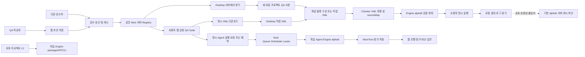

# 사용자 웹·관리 작업공간 기획 및 화면설계

기준일: 2026-11-11. 담당: web_planner. Checker `main / 4f97e920a399d4a5434ab1ecbe44c4d879d397a4`의 기존 변경 중 작업 트리를 읽어 조사했다. 이 문서는 기획 산출물이며 새 웹 라우트나 운영 기능 구현 완료 보고가 아니다. 제품과 목업 구현은 checker_owner가 소유한다.

## 기획 기준과 적용 스킬

사용자 원본 `automated_qa_codex_instructions`의 CHECKER, MASTER, PHASES, CONTRACTS 요구를 최신 역할 결정으로 정합했다. 사용자 웹은 공용 QA/XML 전달·진행 관찰 앱이고, 관리 작업공간은 같은 웹·같은 Nest API의 권한별 업무다. Desktop은 로컬 프로젝트 및 XML 파일 블록/직접 XML 편집·검증·명시 실행 앱이다. Engine은 독립 package/API/CLI다.

`C:/Users/Domin/.codex/skills/frontend-design/SKILL.md`, `qa-workbench-design/SKILL.md`를 읽고 적용했다. 별도 범용 제품기획 스킬은 현재 제공 목록에 없다. 관련 없는 문서/Figma/Pages 스킬을 기획 근거 대신 적용하지 않는다. 명세·화면·상태·수용 기준을 먼저 정리하고 기존 도메인과 실제 계약으로 검토한다.

디자인 계획: Desktop은 작업 배경 #1c1c1c, 상단 #292929, 패널 #323232, 입력 #414141, 본문 #e0e0e0, 선택 #8ea8bd를 유지한다. 웹·기획 검토는 긴 목록·검수 읽기에 맞춘 밝은 중립 문서형으로 정합한다. 배경 #f5f5f3, 표면 #ffffff, 구분선 #d4d4d0, 본문 #272727, 보조 #61615e, 선택 #dce5eb다. 공통 Segoe UI/Malgun Gothic, 본문 13px, 패널 제목 14px, 페이지 제목 20px, 제어 12~13px와 4px 간격을 사용한다. 웹도 프로젝트와 목록을 먼저 보여 주되 Desktop의 그래프 편집기를 복제하지 않는다. 목록/선택 상세/실행 증거를 작업 단위로 구분한다. KPI 카드·마케팅 문구·장식 그라데이션을 넣지 않는다. 화면설명은 검토용 기획 패널에, 사용자 행동은 제품 화면에 둔다. 관리 검토에서 전체 dark 웹 초안을 수정했으며 대표 화면 시각 검수로 최종 인수한다.

## 현재 실사와 변경 이유

현재 실제 웹 라우트는 `/`, `/qa/blueprints`, `/qa/shared`다. `App.jsx`가 두 기능 진입을 제공하고 `BlueprintPage`가 XML/Blueprint와 공유 화면을 전환한다. `SharedScenarios` 아래 Registry·RunWork·SuiteExecutions가 연결·작성·검수·게시·수신·실행·업무·예약·감사를 긴 한 화면에 모았다. 기능 존재와 사용하기 좋은 화면 구성은 별개다.

이번 설계는 프로젝트 선택 → 게시 QA/Suite → 선택 상세 → 명시 전달 → 실행 관찰이라는 사용자 맥락을 복구한다. 관리자는 검수/게시, 업무/비교, 예약/운영으로 이동한다. 아래 제안 경로는 화면 식별용이며 실제 새 라우트 구현을 뜻하지 않는다. 별도 관리자 서버를 만들지 않는다.

## 역할별 기능과 권한

실제 서버 역할 순서는 `viewer < qa_tester < qa_editor < qa_manager < system_admin`이다. 모든 권한은 프로젝트 membership과 활성 사용자 기준이며 UI 숨김만으로 보안 검사를 대신하지 않는다.

| 기능 | 최소 현재 권한 | 제품 의미 |
| --- | --- | --- |
| 프로젝트/게시 QA/Suite/실행/증거 조회 | viewer | 본인에게 허용된 프로젝트만 |
| 고정 XML 파일 다운로드 | viewer | 조회한 XML의 명시 파일 전달; 실행 아님 |
| 개인 버전 pin, Agent 요청·취소, 예약 생성·활성/중지 | qa_tester | 사용자에게도 제공; 관리자 독점 기능 아님 |
| 실행 업무 수정·담당자 변경·기준 실행 선택 | qa_tester | Run의 업무이며 개인 QA 수신함 할당 아님 |
| QA/Suite 초안 생성 | qa_editor | 실행 가능한 XML/고정 case 목록 검사 후 생성 |
| 독립 검수·게시 | qa_manager | 작성자 자신이 검수할 수 없음; 현재 활성 검수 권한 재검사 |
| 감사, 알림 요청, 불확실 실행 운영 복구 | qa_manager | 전송 실패/복구가 Engine 판정을 바꾸지 않음 |
| 사용자·팀·프로젝트 생성·역할 CRUD UI | 미구현 | 사전 provisioning만 존재; 관리자 기획 요구로 유지 |
| Agent/디바이스 전체 재고·등록 UI | 미구현 | 로컬 관리 provisioning/Agent 프로토콜과 구별 |

`system_admin`도 현재 프로젝트 membership 경계를 따른다. 전 조직 데이터의 무제한 조회를 목업에서 암시하지 않는다. 업무 네비게이션 위치와 API 최소 권한은 다른 개념이다.

## 화면 목록 및 구조

`W`는 사용자 웹, `A`는 역할별 관리 작업공간이다. 현재 기능이 있는 항목도 아래 화면 분리는 제안이다. `P`는 프로젝트 ID, `R`은 서버 Run ID, `V`는 고정 버전 ID. API 표의 모든 경로는 `/api/v1` 기준이다.

| ID / 화면 | 현재 route·component | 제안 화면 경로 | 핵심 목적·구성 | 상태/구현 근거 |
| --- | --- | --- | --- | --- |
| W01 조직 연결·프로젝트 | /qa/shared · SharedScenarios | /qa/projects | 조직 로그인, 소속 프로젝트 목록, 역할, 현재 선택 | 인증/프로젝트 API 구현; 독립 목록 화면 제안 |
| W02 공용 QA 목록 | /qa/shared · SharedScenarios | /qa/projects/P/library | QA/Suite 탭, 이름·버전·게시일, 선택 상세 | Registry/Suite 목록 구현; 정보구조 개선 |
| W03 QA 버전 상세·전달 | /qa/shared · SharedScenarios | /qa/projects/P/library/V | 제목·출처·고정 버전·XML·이전 pin 차이; XML 다운로드/버전 고정 | 파일 다운로드·hash 확인·pin 구현 |
| W04 Suite 상세 | /qa/shared · SuiteExecutions | /qa/projects/P/suites/V | 순서 있는 case·각 고정 버전·실패 후 중지 정책 | 서버 Suite 구현; Desktop은 case 하나씩 수신 |
| W05 실행 목록·진행 | /qa/shared · SharedScenarios | /qa/projects/P/runs | 실행시각·QA·실행 판정·증거·업무를 분리한 표 | 목록·polling 구현; 새 표 화면 제안 |
| W06 실행 상세·증거 | /qa/shared · SharedScenarios/Blueprint | /qa/projects/P/runs/R | 고정 snapshot, 단계 로그, 실패 위치, 검증 PNG | alpha5 실제 기록 웹 관찰 검증 이력 |
| W07 XML 전달 도구 | /qa/blueprints · BlueprintPage | /qa/blueprints | XML/JSON 가져오기·검사·내보내기, 파일 기반 실행 기록 관찰 | 기존 기능 유지; Desktop 그래프 대체 아님 |
| W08 Agent 실행 요청 | /qa/shared · SuiteExecutions | /qa/projects/P/executions/new | 고정 QA 또는 Suite와 대상 scope 선택·명시 요청 | 요청 API/웹 UI 검증; queued는 실행 성공 아님 |
| A01 초안·검수 목록 | /qa/shared · SharedScenarios/SuiteExecutions | /qa/projects/P/manage/reviews | QA/Suite 초안, 작성자·검수자·state, 검수/게시 상세 | 기존 API; 역할별 독립 작업 목록 제안 |
| A02 QA/Suite 작성·게시 | 같은 component | /qa/projects/P/manage/reviews/id | QA XML 또는 Suite case 순서, 의존 버전, 검수 후 새 버전 게시 | 수정·반려·폐기 API는 없음; 없는 버튼은 계획 표시 |
| A03 업무·비교 | /qa/shared · RunWork | /qa/projects/P/manage/work | Run 담당자/업무상태, revision, 비교 가능한 이전 실행 | API·실제 alpha5 증거 비교·웹 검증 |
| A04 예약·발생 이력 | /qa/shared · SuiteExecutions | /qa/projects/P/schedules | 고정 QA/Suite, 요일·현지시각·IANA TZ, 대상, 발생 이력 | tester 이상 가능; 별도 화면 제안 |
| A05 Agent 실행·복구 | /qa/shared · SuiteExecutions | /qa/projects/P/executions/id | queued/claimed 등 상태, case Run, 취소요청, 운영 복구 | 실행상태·복구 API; 전체 Agent 재고 UI 아님 |
| A06 감사·알림 | /qa/shared · SharedScenarios/RunWork | /qa/projects/P/manage/audit | 행위자·대상·시간·처리결과와 알림 전달 상태 | 감사 API·local-test 알림; 실제 Slack 발송 미구현 |
| A07 사용자·팀·권한 | 없음 | /qa/projects/P/manage/members | 역할/초대/비활성 관리의 후속 설계 | API/제품 UI 미구현; 계획 전용 |
| A08 Agent·리소스 관리 | 없음 | /qa/projects/P/manage/resources | 등록 resource·Agent 가용성·capability·lease 조회 | 전체 목록/등록 HTTP 및 UI 미구현; 계획 전용 |

제안 네비게이션은 사용자 영역 `프로젝트 / 공용 QA / 실행 기록 / 예약`과 권한별 `검수·게시 / 업무·비교 / 운영 / 감사`다. 권한이 없는 기능은 숨기거나 이유 있는 읽기 전용으로 표시하며 목업 역할 전환은 예시 데이터 전환임을 한 번 명시한다. 프로젝트 변경 시 이전 프로젝트 선택/비동기 응답을 무효화한다.

## 화면별 상세 설계

### W01 조직 연결·프로젝트

- 입력: 서버 주소, 조직 로그인. 개발 token은 고급 개발 연결에만 표시한다. 로그인 완료 후 사용자와 membership 프로젝트를 보여 준다.
- 액션: 조직 로그인, 세션 확인/자동 복귀, 프로젝트 선택, 로그아웃. 현재 제품은 세션 확인 수동 버튼이며 자동 복귀 화면 개선은 제안이다.
- 상태: 연결 전/로그인 중/프로젝트 로딩/소속 없음/만료/403/서버 오프라인. 소속 없음은 프로젝트 생성 성공처럼 채우지 않는다.
- API: `GET auth/start`, callback, `GET auth/session`, `POST auth/logout`, `GET me`, `GET projects`(cursor).
- 연결: 선택은 W02/W05 범위만 바꾸며 Desktop 로컬 프로젝트를 생성하거나 덮어쓰지 않는다. 외부 Slack 실계정 검증은 별도 미완료다.

### W02 공용 QA 목록

- 입력/표시: 서버 프로젝트, QA/Suite 탭, 현재 불러온 항목 검색, 이름·버전·게시일. 서버 전역 제목 검색 API는 없고 packageId 필터만 존재한다.
- 액션: 상세 열기, 다음 페이지, 새로고침, 권한 있으면 초안 작성. 빈 목록은 '게시된 QA가 없습니다', 필터 결과 0은 '검색 결과가 없습니다'로 구별한다.
- API: `GET projects/P/registry/versions`, `GET projects/P/suites/versions`.
- 연결: W03/W04 → Desktop의 `서버에서 받기`. 사용자에게 개인 할당된 항목이라는 뜻의 '내 할당 QA'를 쓰지 않는다.

### W03 QA 버전 상세·전달

- 표시: package/title/version, XML 원문, SHA, 게시 Engine version, 이전 개인 pin과 변경 여부, dependency. hash는 상세 정보에 접고 행동 앞에는 버전·변경 요약을 보여 준다.
- 액션: 고정 XML 다운로드, 변경 확인 후 버전 고정(tester 이상), Desktop 수신 안내. 다운로드/고정으로 실행하지 않는다. 딥링크로 실행 중 앱에 전송되는 기능은 구현되지 않았다.
- API: `GET registry/versions/V`, `GET registry/pins`, `GET registry/upgrade-diff?fromVersionId=...&toVersionId=...`, `PUT registry/pins`(모두 projects/P 하위).
- 예외: hash 불일치→수신 차단/재조회, 409→선택 버전 재확인, 403→읽기 가능/고정 불가를 분리. 새 version은 기존 version을 변경하지 않는다.
- Desktop: `서버에서 받기` → `받을 수 있는 QA` 선택 → 로컬 프로젝트/이름 지정 → 새 QA. 동일 버전은 기존 사본 열기/새 사본 받기를 분리한다. 원문 receipt와 로컬 편집본을 보존한다.

### W04 Suite 상세

- 표시: Suite 고정 버전과 case 순서·caseId·각 Registry 버전·stopOnFailure. Registry Suite는 Engine raw Suite XML과 다르다.
- 액션: Suite pin, case 상세, Agent 전체 Suite 요청, Desktop에서는 case 하나 선택 후 새 로컬 QA 수신.
- API: `GET projects/P/suites/versions/V`, `PUT projects/P/suites/pins`.
- 예외: 누락/변조 case·호환되지 않는 pin은 수신/실행을 차단한다. Suite 자체를 Desktop에서 일괄 실행하는 버튼은 계획 기능으로 남긴다.

### W05/W06 실행 목록·상세

- 표시: 서버 Run ID와 Engine runId/attempt/snapshot을 구분한다. 실행 판정, evidence 정합, 업무 status는 별도 열이다. 상세는 실행 당시 snapshot을 읽기 전용으로 연다.
- 액션: 목록 갱신, 상세 보기, 진행 수신 중지/재연결, 검증된 PNG 보기, A03 업무·비교 이동.
- API: `GET projects/P/runs`, `/runs/R`, `/runs/R/events?afterSequence=...`, `/runs/R/artifacts/artifactId`.
- 상태: 진행 중/terminal, 수신 끊김/재연결, events gap·identity 불일치, 증거 pending/verified/오류. verified는 자료 정합성이지 테스트 성공/실기기 보증이 아니다.
- 예외: 이미지 없으면 미수집 이유 표시, broken image로 채우지 않는다. 서버 연결 실패는 로컬 실행 판정을 실패로 변경하지 않는다.
- Engine alpha8 Desktop 결과를 기본 alpha6 서버에 자동 업로드하거나 웹에 즉시 표시한 듯 연결하지 않는다. 화면에는 `로컬 결과 보관됨 / 공유 호환성 불일치`를 별도로 표시한다. 과거 alpha5/alpha6 공유 성공 이력은 alpha8 호환 증거가 아니다.

### W07 XML 전달 도구

- 기존 JSON/XML 가져오기·유효성 확인·XML 내보내기와 Engine 이벤트 파일 관찰을 유지한다. 새 웹 그래프 작성기를 Desktop 수준으로 확장하지 않는다.
- 파일 검사/내보내기에는 서버 로그인이나 실행이 필요하지 않다. 웹에서 XML 검사와 실제 Engine 실행 검증의 범위를 동일하게 표시하지 않는다.
- 작성 중 문서와 외부 실행 snapshot 전환을 분리하고, 외부 실행 표시를 현재 초안 성공 상태로 합치지 않는다.

### W08 Agent 실행 요청

- 입력: 게시 QA 또는 Suite 중 하나, 고정 SHA, resource key, platform, 허용 origin 또는 native app/activity, secretRef 이름, 운영 환경 명시 opt-in.
- 액션: 요청 내용 확인 → Agent 실행 요청 → A05. 요청이 접수되어 queued여도 실행 성공이나 기기 연결로 표시하지 않는다.
- API: `POST projects/P/executions`; 최소 tester. 현재 리소스 자동 목록 API가 없으므로 제품처럼 풍부한 live device picker를 꾸미지 않는다.
- 예외: resource 미등록/범위 초과/버전 불일치/적격 Agent 없음. Secret 값 입력은 만들지 않는다. 사용자 요청 scope와 Agent 운영자 allowlist의 교집합에서만 실행한다.

### A01/A02 초안·검수·게시

- 목록: QA/Suite 구분, 제목, 작성자, 상태 draft/reviewed/published, 검수자, 수정 대상 선택. QA XML 또는 Suite case 순서·고정 버전 목록을 상세에 표시한다.
- 입력: packageId/title/XML/dependencies 또는 Suite cases(1~32, 고유 caseId)/stopOnFailure; 게시할 semantic version.
- 액션: 초안 저장(editor), 다른 manager의 검수 승인, 게시(manager). 게시 요청 멱등키를 같은 시도 재전송에 재사용한다. 본인 검수/권한 상실/중복 version/변조 SHA에는 명확한 이유를 표시한다.
- API: `projects/P/registry/drafts` 및 `projects/P/suites/drafts` GET/POST, 각 `/:id/review`, `/:id/publish` POST.
- 없음: 초안 수정/반려/폐기·published deprecate API는 현재 없다. 기획에 남기되 동작하는 것처럼 만든 버튼은 금지한다. 수정은 현재 새 초안 생성의 의미를 정확히 안내한다.
- 전달: 게시 후 W02/W03에서 사용자가 발견한다. 이것은 개인 assignment 생성이 아니다.

### A03 업무·비교

- 입력: Run 업무 status(todo/in_progress/done), 활성 프로젝트 담당 사용자 ID, 현재 revision, 명시 baseline Run.
- 액션: 업무 저장, 충돌 후 새로고침·재선택, 자동 비교, 기준 실행 선택. 담당자 선택 목록 API가 아직 없으므로 현재 ID 입력과 후속 사용자 picker를 구분한다.
- API: `GET/PUT projects/P/runs/R/work`, `GET .../comparison`, `PUT .../baseline`.
- 상태: 업무 done이어도 Engine failed는 그대로. 비교 가능 조건은 snapshot/target/Engine version/검증된 profile-reference 집합이다. 환경 증거 없음/불일치에는 비교 불가 이유를 표시한다.
- 한계: 이는 Run 담당자 배정이다. TC/Suite의 개인 배포·기한·완료 inbox는 후속 독립 계약이 필요하다. 이미지 기준 파일 승격도 비교 버튼 기능이 아니다.

### A04 예약·발생 이력

- 입력: 고정 QA/Suite와 실행 scope, IANA 시간대, 현지시각, 요일, 허용 지연 초, 활성 여부. 요청자는 tester 이상이며 관리자만의 기능으로 제한하지 않는다.
- 액션: 예약 저장, 활성/중지, occurrence 조회. 기존 예약 내용 전체 수정/삭제 API는 현재 없으므로 새 예약 생성과 혼동하지 않는다.
- API: `GET/POST projects/P/schedules`, `PUT .../schedules/id/enabled`, `GET .../schedules/id/occurrences`.
- 상태: queued/missed 등 occurrence와 실제 Run 판정 분리. DST 없는 시각·늦은 scheduler·권한 취소·pin 불일치의 missed 이유 표시. Desktop 종료와 무관한 서버 예약임을 안내한다.
- 연결: occurrence→execution→case Run→W06. 실행이 없으면 Run 링크를 만들어 내지 않는다.

### A05 Agent 실행·복구

- 표시: 실행 요청 state/사유, cancelRequested, caseRuns, evidence; manager만 resourceKey/fence/cleanup/recovery 상세를 본다.
- 액션: 상태 수신/재연결, 취소 요청, case 결과. qa_manager는 불확실 실행의 실제 소유 프로세스·외부 세션 종료를 확인하고 사유를 남긴 후 격리 해제 요청한다.
- API: `GET projects/P/executions`, `/executions/id`, `POST .../cancel`, `POST .../recovery`.
- 상태: queued/claimed/reporting/completed/cancelled/missed/expired/quarantined/recovered 등 서버 원문과 사용자 설명을 짝지어 표현한다. expired는 프로세스 종료 증거가 아니고 recovered는 이전 결과 성공이 아니다. 취소요청과 terminal cancelled는 분리한다.
- 한계: Agent registration/realtime fleet/device inventory UI는 없다. 운영 구성된 resource의 실행 정보와 미구현 fleet 화면을 구분한다.

### A06 감사·알림

- 감사 목록: 시간·행위자·action·대상, 다음 페이지. API `GET projects/P/audit`(manager).
- 알림: terminal Run의 전달 요청·상태 조회, `POST/GET projects/P/runs/R/notifications`. 현재 local-test HTTP fixture 전송이다. 실제 Slack 계정/채널 전송은 미완료다.
- 전달 실패를 Run 실패로 바꾸지 않고 알림 상태를 별도 표시한다. 원본 XML/PNG/secret을 알림 payload의 기본 내용으로 넣지 않는다. 현재 독립 수동 retry API가 있다고 표시하지 않는다.

### A07/A08 후속 기획 화면

사용자/팀/프로젝트 관리, 초대·비활성·역할, 개인 Suite 할당과 기한, Agent/기기 재고는 원본 제품 요구에 남는다. 이번 목업은 '계획' 표시와 필요한 필드·승인 경계·연결 화면을 보여 줄 수 있으나 존재하지 않는 GET/POST API나 제품 성공 토스트를 만들지 않는다. 서버 계약 → OpenSpec → 구현 → 인수의 별도 작업으로 추적한다.

## 앱 간 관계와 주요 여정

이 도식의 점선은 현재 연결 제한이며 성공 경로가 아니다. XML 다운로드 후 Desktop에서 명시적으로 여는 파일 경로와 Desktop 자체의 인증된 Registry 수신을 구별한다. 외부 CI/Engine는 Checker 없이 실행할 수 있다.

| 여정 | 시작 → 종료 | 핵심 수용 기준 |
| --- | --- | --- |
| 게시 QA 로컬 편집 | A02 게시 → W02 발견 → Desktop 수신 → 새 QA → 직접 XML/블록 → 검증 → 명시 실행 | 원본 버전·SHA·로컬 identity 보존, 기존 문서 덮어쓰기 없음, 수신 실행 횟수 0 |
| XML 파일 전달 | W03 다운로드 → Desktop 파일 열기 → 검증 → 실행 | deep link 자동 실행 없음, 원문 보존 |
| Suite 단건 수신 | W04/서버목록 → Suite pin → case 선택 → 새 로컬 QA | Suite 일괄 실행으로 오인하지 않음 |
| 서버 반복 QA | W04 → A04 예약 → occurrence → Agent → W06 | 앱 종료 후에도 서버 관리, missed/infra_error를 PASS로 만들지 않음 |
| 실패 triage | W06 failed → A03 담당·업무 done → 비교 | outcome failed 불변, 업무와 비교 별도 |
| 실행 취소·운영 복구 | A05 취소요청 → terminal/불확실 확인 → 권한 있는 복구 | 요청과 종료 구분, lease TTL을 cleanup 보증으로 사용하지 않음 |
| 오프라인 작업 | Desktop 가져온 QA → 기존 사본 열기 → 저장/실행 | 서버 오프라인이 로컬 프로젝트를 막지 않음 |

## 상태 계약 표

| 상태 축 | 예시 | 바꾸지 않는 것 |
| --- | --- | --- |
| Engine 실행 판정 | passed / failed / blocked / infra_error / cancelled, 후속 unrun | 업무 완료·전송 실패가 판정을 덮어쓰지 않음 |
| 실행 요청·Agent lease | queued / claimed / reporting / expired / quarantined 등 | 요청 접수는 실행 성공 아님 |
| 증거 정합 | pending / verified / 오류 | verified는 테스트 성공·실기기 인증 아님 |
| 사용자 업무 | todo / in_progress / done + revision | done은 passed 아님 |
| 예약 occurrence | queued / missed + reason | missed는 성공이나 자동 재실행 아님 |
| Desktop 공유 전송 | 미요청 / 전송 대기 / 전송 실패 / 공유 호환성 불일치 | 로컬 result와 판정 보존 |

## 실사 근거와 검증 범위

현재 코드: `apps/web/src/app/App.jsx`, `features/shared-scenarios/{SharedScenarios,RunWork,SuiteExecutions}.jsx`, `apps/server/src/modules/{platform,workflow,suite,scheduler,agent,auth}/*controller.ts` 및 각 service. 실제 권한은 controller 설명만이 아니라 service.authorize를 확인했다.

| 근거 파일(Checker 상대) | 확인한 증거 | 한계 |
| --- | --- | --- |
| artifacts/shared-web-verification.json | alpha5 실제 결과 Registry/polling/PNG 웹 표시 | alpha8 서버 업로드 인수 아님 |
| artifacts/organization-web-verification.json | localProvider, cookie/CSRF/logout | realSlack=false |
| artifacts/workflow-web-verification.json | 실제 alpha5 failed + 업무 done + regression, localNotification | externalNotification=false |
| artifacts/suite-web-verification.json | orderedCases2, 독립검수, pin 비실행, 요청/예약/복구UI | agentActuallyExecuted=false; fixtureOnly 복구 |
| docs/validation.md | 별도 alpha6 fresh/Agent 통합 이력 및 한계 | 이번 새 화면 실제 제품 인수 아님 |
| docs/validation-project-home.md | 새 Desktop 홈 인수 결과의 담당자 문서 | 최종 native/Release gate는 root가 별도 확정 |

이번 웹 기획 조사는 테스트를 재실행하지 않았다. 코드/기존 artifact를 직접 읽었으며 새 화면의 목업 상호작용 검증은 Checker 담당과 root 검토 결과를 추가해야 한다.

## 발견한 누락·모순 및 후속 처리

1. 기존 홈 없는 편집기 중심 흐름은 사용자 요청을 누락했다. Desktop/목업 홈과 프로젝트·서버수신을 기본 진입으로 유지한다.
2. 서버 게시 QA를 '내게 할당된 QA'라고 부르면 현재 계약과 다르다. 게시QA/Suite·가져온 로컬QA·Run 담당업무를 구별한다.
3. `SharedScenarios` 초안은 서버 `state` 대신 `d.status`를 표시한다. 실제 웹 수정 대상이며 이번 기획 문서가 제품 수정 완료를 뜻하지 않는다.
4. 같은 component의 감사 자동조회 조건은 `qa_manager/admin`이지만 계약은 `system_admin`이다. 역할 판별·사용자 노출을 후속 수정한다.
5. 구형 `shared-scenarios.md`의 workStatus=todo뿐/예약 미구현 문구와 org 문서 alpha5 고정 문구는 최신 구현보다 오래됐다. 통합 기획은 실행 manifest와 최신 인수일을 우선하며 문서 정합 후속 필요.
6. 사용자/팀/프로젝트 CRUD, 개인 Suite Assignment inbox, deprecate/반려, live Agent 재고, 외부 Slack 발송은 원본 요구 중 미완료다. 완료처럼 꾸미지 않는다.
7. 기존 shared UI에는 관리자용 양식도 일반 사용자에게 보이며 서버에서 거부한다. 제안 목업은 역할별 진입/제어 노출을 개선하고 서버 강제 권한을 유지한다.
8. 기본서버 alpha6와 Desktop alpha8의 실제 결과 공유는 호환되지 않는다. receipt 출처 보존·로컬 실행과 공유 결과 호환을 별도 계약으로 추적한다.

## 목업 업그레이드 인수 기준

- 검토 상단에서 사용자 웹/사용자 Desktop/관리 작업공간/관계도·기획/화면설계서를 오갈 수 있다. 제품 chrome 안에 개발 상태 설명을 과도하게 넣지 않는다.
- 화면마다 ID·역할·목적·입력·행동·상태·API·연결·구현근거를 검토 패널에서 확인한다. 실제 기능/기획 제안/검증 제한을 표시한다.
- 최소 여정: 관리 게시 → 사용자 QA 발견 → Desktop 신규 수신 → 실행 → 로컬 결과와 공유 제한, Agent 요청/예약 → 서버 실행 관찰 → 업무 완료를 클릭한다.
- 권한 없음/빈 목록/검색 0/오프라인/409 revision/잘못된 hash/버전 호환 불일치/취소요청/증거 미수집 상태가 검토 가능하다.
- 1440×900 및 1024×768에서 한국어·긴 이름·표·상세·하단 액션이 겹치지 않으며 핵심 버튼은 스크롤 또는 패널 접기로 도달한다.
- 예시 데이터 시뮬레이션은 검토 chrome에 표시하고 실제 네트워크·계정·발행·Engine 실행처럼 보고하지 않는다. 현재 Flutter Release 홈 인수와 목업 인수를 구분한다.

