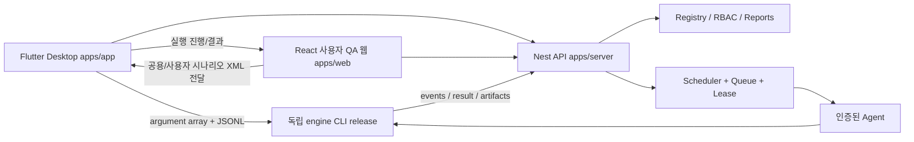

# Checker 시스템 설계

앱별 배치·의존 규칙·실행 정책의 기준은 [모노레포 정책](monorepo-policy.md)이다.

## 앱과 저장소 경계

사용자 웹·Desktop·관리자 권한업무는 하나의 서버 API를 공유한다. 웹은 공용 테스트·XML 전달·진행 확인, Desktop은 블록/Flow 또는 XML 테스트 개발·실행을 담당한다. GUI/API는 Appium/Playwright를 직접 구현하지 않는다. 위 전달 화살표는 목표이며 첫 파일 전달과 후속 서버 자동 동기화는 구분한다.

| 경로 | 목표 역할 | 현재 상태 |
| --- | --- | --- |
| apps/server | Nest module/controller/service, config/common, /api/v1 | 경계 README만 |
| apps/web | React 사용자 공용 QA·XML 전달·진행 SPA, 역할별 관리 기능 | JSON 편집/graph/event replay/file follow 검증; XML export 중간 수정 미검증 |
| apps/app | Flutter Desktop 기능별 MVVM/Provider | 초안 원문 편집·파일 열기/저장 shell, Windows build 검증; pnpm 제외 |
| packages/contract | 향후 서버 OpenAPI 및 외부 engine public contract 소비 경계 | hash 고정 engine JSON Schema + validator 구현; 서버 OpenAPI 미구현 |
| packages/api-client | 같은 OpenAPI로 생성한 TS SDK | 경계 README만 |
| packages/api_client_dart | 같은 OpenAPI로 생성한 Dart SDK | 경계 README만, pnpm 제외 |
| packages/typescript-config | JS 앱들의 공통 compiler 정책 | 경계 README만 |
| scripts | foundation 검사와 SDK 환경 진단 | 실행 가능 |

이 경로는 scratch-3d feature의 아직 구현 전인 모노레포 설계를 채택한 것이다. [조사 근거](repository-audit.md)를 따른다.
현재 pnpm package는 root, apps/web, packages/contract다. apps/web은 실제 build와 browser 인수를 제공한다. Flutter는 별도 SDK의 MVVM/Provider shell이며 [구조 안내](flutter-mvvm.md)를 따른다. 서버와 엔진 미연결 기능에는 성공 placeholder를 넣지 않는다.

## 의존 방향

- apps/web → 생성 api-client → HTTP. FSD에서 상위 레이어를 하위 레이어가 import하지 않는다.
- apps/app → 생성 api_client_dart + engine CLI bridge. UI graph 좌표와 execution semantics를 분리한다.
- apps/server DTO/controller → OpenAPI export → TS/Dart SDK. 서버가 생성 client를 import하지 않아야 한다.
- engine execution schemas → release artifact → Checker validator/editor. packages/contract가 engine schema의 원본이 되지 않는다.
- app 간 상대 source import, engine 소스 복사, 커밋된 file/link dependency, submodule은 금지한다.

## 제품 화면 설계

웹: 공용/사용자 시나리오 확인·편집 → XML 전달 → 테스트 진행 확인. Desktop: 프로젝트 선택 → TC/Suite 목록 → 블록/Flow builder 또는 XML 전체 편집 → validation/plan → device picker → 명시 실행 → Run 상세. Flow builder는 nodes/edges와 node settings, selector/input/assertion, timeout/retry, context preview, undo/redo, validation errors를 제공하는 목표다.
Run 상세는 단계별 로그/증거/실패 원인/결과 버전/재실행을 표시한다. Device picker는 연결됨/사용중/미지원을 구분한다.
관리자: 사용자·팀·역할, 프로젝트, 표준 QA 검수/게시/폐기, 담당자 배정, Agent/기기, 일정/미실행, 결과 triage, 감사/알림 재시도.

## 순서

P2는 로컬 Flow 편집→engine CLI→결과만 연결한다. 인증/Registry는 P3, scheduler/Agent/weekly reporting은 P4로 나눈다.
Flutter Desktop 생성/build는 P2 tasks다. 기존 문서의 웹 관리자 전용 설명은 최신 사용자 요구에 따라 사용자 QA 웹으로 정정했다. 실제 CLI 직접 실행은 아직 연결하지 않았다. 모노레포 상세 기반과 HTTP health/codegen 인수는 [이관 설계](../../openspec/changes/refactor-server-web-app-monorepo/design.md)를 따른다. health bootstrap은 P3 OIDC/Registry 제품 구현과 구분하고 로컬 P2는 서버 없이 가능해야 한다.

