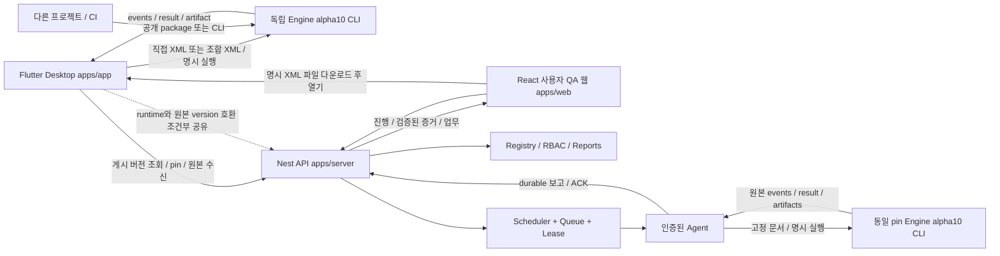

# Checker 시스템 설계

앱별 배치·의존 규칙·실행 정책의 기준은 [모노레포 정책](monorepo-policy.md)이다.

2026-11-13 현재 source: `features/project_workspace`의 파일 저장/프로젝트·QA·지침, `features/ai_authoring` 및 복수 interactive terminal, Engine document authoring 소비, 상위 `app/workbench/DesktopWorkspaceViewModel`의 검증·적용·실행 순서를 제공한다. Desktop과 새 서버/Agent local lane은 검증 alpha.10으로 정합했다. 서버 현재 manifest는 packages/contract/runtime/engine-runtime.json이며 legacy alpha.6 계약·설치·assets는 역사 회귀용으로 보존한다. [서버 연결](../server-runtime-alpha10.md)과 [Portable 안내](../portable-desktop-quickstart.md)의 실제 인수 범위를 따른다. portable 조립/같은 PC 경로 이동과 실제 다른 PC 실물 검증은 구분한다.

## 앱과 저장소 경계

사용자 웹·Desktop·관리자 권한업무는 하나의 서버 API를 공유한다. 웹은 공용 테스트·XML 전달·진행 확인, Desktop은 블록/Flow 또는 XML 테스트 개발·실행을 담당한다. GUI/API는 Appium/Playwright를 직접 구현하지 않는다. 파일 전달과 인증된 Registry 수신·진행 polling, 독립 Agent·Suite 순차 실행·예약을 구현하고 실제 서버 통합으로 검증했다.

결과 수집·서버 전달의 주체는 Desktop 또는 Agent이며 Engine이 웹/서버에 직접 업무 결과를 게시하지 않는다. 새 서버/Agent demo의 기본 lane은 alpha.10이고 운영 bootstrap은 계속 명시 runtime/인증 환경 설정을 요구한다. 기존 alpha.6 서버를 자동 승격하지 않으며 새 Desktop 결과를 옛 서버에 보내면 exact runtime 검사로 거부하고 로컬 판정을 보존한다. 실제 alpha.10 PNG 게시·Suite·예약·취소와 alpha.6 history 조회 보존은 [새 통합 인수](../validation-server-runtime-alpha10.md), 과거 홈 수신은 [그 시점 인수](../validation-project-home.md)로 구분한다.

| 경로 | 목표 역할 | 현재 상태 |
| --- | --- | --- |
| apps/server | Nest module/controller/service, config/common, /api/v1 | health/Registry/RBAC/events/evidence/영속SQLite, local OIDC provider·업무·Suite·Agent·예약 통합 검증 |
| apps/web | React 사용자 공용 QA·XML 전달·진행 SPA, 역할별 관리 기능 | JSON/XML, Registry·Suite 검수·pin, 인증된 진행/검증 이미지, 조직 로그인·업무 비교·예약·복구 폼 |
| apps/app | Flutter Desktop 기능별 MVVM/Provider | XML/Flow/반복, CLI validate/plan/run/cancel, 디자인/UX·증거·Registry·조직 로그인; Windows build 검증; pnpm 제외 |
| packages/contract | 서버 OpenAPI 및 외부 engine public contract 소비 경계 | 현재 runtime/alpha.10 exact manifest, legacy alpha.6 JSON Schema/validator 보존, HTTP OpenAPI/generator 및 Agent 업무 계약 |
| packages/api-client | 같은 OpenAPI로 생성한 TS SDK | 생성 SDK·오류 adapter·웹 연결 |
| packages/api_client_dart | 같은 OpenAPI로 생성한 Dart SDK | 생성 Dart SDK·오류 adapter, pnpm 제외 |
| packages/typescript-config | JS 앱들의 공통 compiler 정책 | 경계 README만 |
| scripts | foundation 검사와 SDK 환경 진단 | 실행 가능 |

이 경로는 scratch-3d feature의 아직 구현 전인 모노레포 설계를 채택한 것이다. [조사 근거](repository-audit.md)를 따른다.
현재 pnpm은 apps/web, apps/server, packages/contract, packages/api-client를 포함한다. apps/web은 실제 build와 browser 인수를 제공한다. Flutter는 별도 SDK의 MVVM/Provider 앱이며 [구조 안내](flutter-mvvm.md)를 따른다. 서버와 엔진 미연결 기능에는 성공 placeholder를 넣지 않는다.

## 의존 방향

- apps/web → 생성 api-client → HTTP. FSD에서 상위 레이어를 하위 레이어가 import하지 않는다.
- apps/app → 생성 api_client_dart + engine CLI bridge. UI graph 좌표와 execution semantics를 분리한다.
- apps/server DTO/controller → OpenAPI export → TS/Dart SDK. 서버가 생성 client를 import하지 않아야 한다.
- engine execution schemas → release artifact → Checker validator/editor. packages/contract가 engine schema의 원본이 되지 않는다.
- app 간 상대 source import, engine 소스 복사, 커밋된 file/link dependency, submodule은 금지한다.

## 제품 화면 설계

웹: 공용/사용자 시나리오 확인·편집 → XML 전달 → 테스트 진행 확인. Desktop: 프로젝트 선택 → TC/Suite 목록 → 블록/Flow builder 또는 XML 전체 편집 → validation/plan → device picker → 명시 실행 → Run 상세. Flow builder는 nodes/edges와 node settings, selector/input/assertion, timeout/retry, context preview, undo/redo, validation errors를 제공하는 목표다.
Run 상세는 단계별 로그/증거/실패 원인/결과 버전/재실행을 표시한다. 실행 대상 확인은 공개 CLI devices 결과로 설치된 Chromium과 정적 Android/iOS 지원·설정 유무를 구분한다. native targets가 비어 있고 connectionVerified=false이면 실제 기기가 연결됐다고 표시하지 않는다. Suite는 Desktop에서 고정 버전의 개별 case를 수신·명시 실행하며 전체 순차 실행은 독립 Agent가 담당한다.
관리 업무의 현재 구현은 표준 QA/Suite 독립 검수·게시, Run 담당/업무, 예약·발생 이력, 실행 운영 복구, 감사와 local-test 알림이다. A07 서버는 명시 managed 모드의 프로젝트 사용자 생성/표시명·활성/membership 관리와 revision·audit·세션 폐기를 제공하지만 A07 웹 화면은 아직 없다. 기본 provisioned 환경에서는 관리 mutation이 미지원이다. 예약/요청은 qa_tester도 가능하며 메뉴 위치와 최소 권한은 구분한다. 팀·프로젝트 CRUD, 개인 QA 할당 inbox, 게시물 폐기/반려, Agent/기기 전체 재고 UI와 외부 Slack 알림은 미완료다. 사전 provisioning이나 새 관리 API를 관리 UI 완성으로 간주하지 않는다.

## 순서

P2는 로컬 Flow 편집→engine CLI→결과만 연결한다. 인증/Registry는 P3, scheduler/Agent/weekly reporting은 P4로 나눈다.
Flutter Desktop 생성/build는 P2 tasks다. 기존 문서의 웹 관리자 전용 설명은 최신 사용자 요구에 따라 사용자 QA 웹으로 정정했다. 실제 CLI 직접 실행과 stdin 취소를 연결했다. 모노레포 상세 기반과 HTTP health/codegen 인수는 [이관 설계](../../openspec/changes/refactor-server-web-app-monorepo/design.md)를 따른다. health bootstrap은 P3 OIDC/Registry 제품 구현과 구분하고 로컬 P2는 서버 없이 가능해야 한다.

